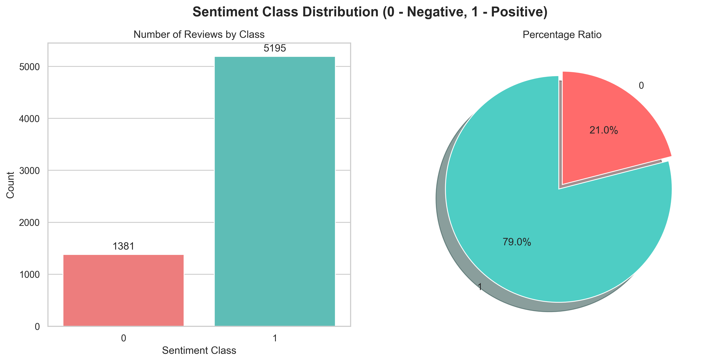
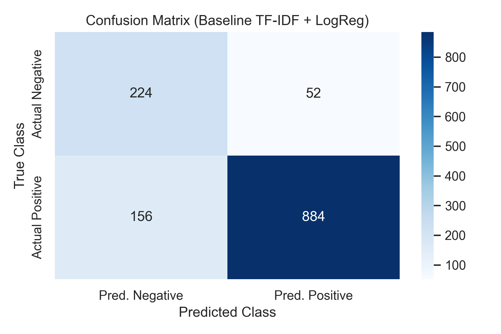
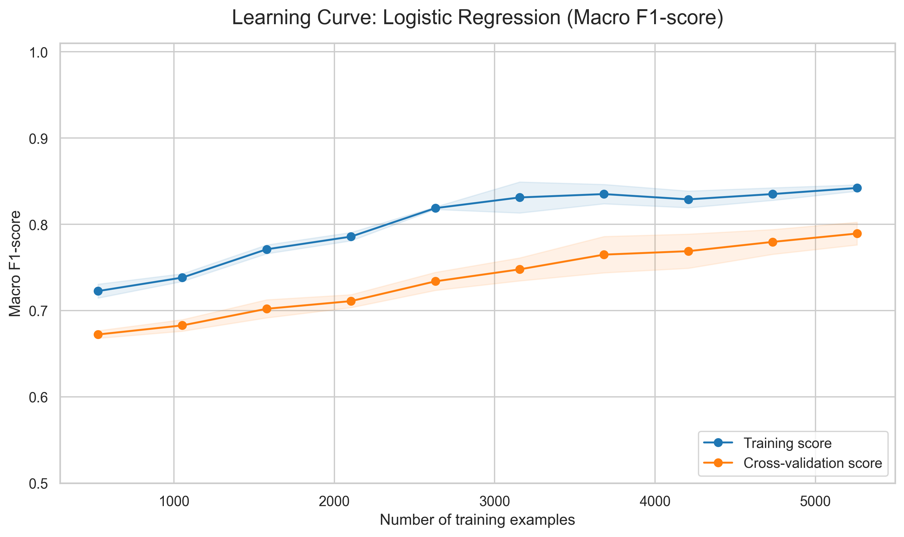

# Kyrgyz Language Sentiment Analysis

[](https://www.python.org/downloads/)
[](https://opensource.org/licenses/MIT)
[](https://huggingface.co/transformers/)

An empirical NLP study and reproducible benchmark for sentiment analysis in the Kyrgyz language (including Kyrgyz-Russian code-mixed texts). This repository contains the complete end-to-end pipeline: automated review scraping from Google Play, hybrid language identification and filtering, dataset preprocessing, classical machine learning baselines (TF-IDF with Naive Bayes, Logistic Regression, Linear SVC), and fine-tuning state-of-the-art multilingual Transformer models (mBERT and XLM-RoBERTa).

---

## Repository Structure

```text
kyrgyzlang_sentiment_analysis/
├── charts/
│   ├── confusion_matrix_baseline.png        # Confusion matrix for Word TF-IDF + Logistic Regression
│   ├── confusion_matrix_baseline_char.png   # Confusion matrix for Char TF-IDF + Logistic Regression
│   ├── learning_curve_macro_f1.png          # Learning curve showing Macro F1 vs training size
│   ├── sent_class_balance.png               # Initial sentiment class distribution
│   └── sentiment_distribution.png           # Binary sentiment distribution & text length analysis
├── data/
│   ├── golden_test_set_300.xlsx             # Hand-curated, human-validated Golden Test Standard (300 reviews)
│   ├── kyrgyz_only_lenient.csv              # Filtered dataset after hybrid FastText + heuristic filtering
│   └── kyrgyz_ready_for_ml.csv              # Processed and labeled binary dataset ready for modeling
├── scripts/
│   ├── applications.txt                     # Target Google Play application package identifiers
│   ├── googleplay_scraper.py                # Review extraction script from Google Play
│   └── kyrgyz_lenient_filter.py             # Rule-based and FastText language identification filter
├── analysis.ipynb                           # Exploratory Data Analysis (EDA) & classical ML baselines
├── transformers.ipynb                       # Fine-tuning & evaluation of mBERT and XLM-RoBERTa
├── requirements.txt                         # Python package dependencies
├── .gitignore                               # Git ignore configuration
└── README.md                                # Project documentation
```

---

## Environment Setup

### Prerequisites
* Python 3.8 or higher
* Recommended: Virtual environment (`venv` or `conda`)
* Optional (for Transformer fine-tuning): CUDA-capable GPU

### Quickstart

1. **Clone the repository:**
   ```bash
   git clone https://github.com/kd0nwww/data-centric-kyrgyz-nlp.git
   cd data-centric-kyrgyz-nlp
   ```

2. **Create and activate a virtual environment:**
   * **Linux / macOS:**
     ```bash
     python -m venv venv
     source venv/bin/activate
     ```
   * **Windows (PowerShell):**
     ```powershell
     python -m venv venv
     .\venv\Scripts\Activate.ps1
     ```

3. **Install dependencies:**
   ```bash
   pip install --upgrade pip
   pip install -r requirements.txt
   ```

---

## Reproducibility Pipeline

To reproduce all experiments from raw data collection to model evaluation, follow the steps below in order.

### 1. FastText Language ID Model Setup

The language isolation script requires the pre-trained FastText compressed model (`lid.176.ftz`). Download it into the repository root directory:
* **Linux / macOS:**
  ```bash
  curl -O https://dl.fbaipublicfiles.com/fasttext/supervised-models/lid.176.ftz
  # or
  wget https://dl.fbaipublicfiles.com/fasttext/supervised-models/lid.176.ftz
  ```
* **Windows (PowerShell):**
  ```powershell
  Invoke-WebRequest -Uri "https://dl.fbaipublicfiles.com/fasttext/supervised-models/lid.176.ftz" -OutFile "lid.176.ftz"
  ```

> **Note on Datasets:** All filtered, cleaned, and benchmark datasets (`data/kyrgyz_only_lenient.csv`, `data/kyrgyz_ready_for_ml.csv`, and `data/golden_test_set_300.xlsx`) are already packaged in this repository. Running the raw scraping step is optional unless you want to re-collect reviews from scratch.

---

### 2. Execution Order

```
[scripts/googleplay_scraper.py]
            │
            ▼
    data/final_raw_database.csv (Raw Scraped Reviews)
            │
            ▼
[scripts/kyrgyz_lenient_filter.py]  <--- lid.176.ftz
            │
            ▼
    data/kyrgyz_only_lenient.csv (Isolated Kyrgyz/Code-Mixed Data)
            │
            ▼
   [analysis.ipynb]
     ├── Generates data/kyrgyz_ready_for_ml.csv
     ├── Samples data/golden_test_set_300.xlsx
     ├── Plots EDA charts (saved to charts/)
     └── Trains & evaluates classical ML baselines
            │
            ▼
 [transformers.ipynb]
     ├── Fine-tunes XLM-RoBERTa (xlm-roberta-base)
     ├── Fine-tunes mBERT (bert-base-multilingual-cased)
     └── Evaluates against the Golden Standard
```

#### Step 2.1: Data Scraping (Optional)
Run the automated review collector against target applications listed in `scripts/applications.txt`:
```bash
python scripts/googleplay_scraper.py
```

#### Step 2.2: Language Filtering
Filter out noise and Kazakh text while preserving Kyrgyz and code-mixed Kyrgyz-Russian reviews:
```bash
python scripts/kyrgyz_lenient_filter.py
```
This produces `data/kyrgyz_only_lenient.csv`.

#### Step 2.3: Exploratory Data Analysis & Classical ML Baselines
Open and execute `analysis.ipynb`:
* Removes ambiguous neutral ratings (score = 3), creating `data/kyrgyz_ready_for_ml.csv`.
* Creates and exports the sample for the human-annotated benchmark `data/golden_test_set_300.xlsx`.
* Trains and benchmarks lexical models:
  * **Multinomial Naive Bayes** (Word TF-IDF)
  * **Logistic Regression** (Word TF-IDF & Character N-gram TF-IDF)
  * **Linear Support Vector Classifier (Linear SVC)** (Word TF-IDF)
* Evaluates learning curves and error distributions.

#### Step 2.4: Multilingual Transformer Fine-Tuning
Open and execute `transformers.ipynb` (recommended on a GPU environment such as Google Colab or a local CUDA machine):
* Fine-tunes `xlm-roberta-base` and `bert-base-multilingual-cased`.
* Evaluates model checkpoints against the human-verified Golden Test Standard (`data/golden_test_set_300.xlsx`).

---

## Results & Visualizations

### Benchmark Performance on Golden Standard Test Set

Models evaluated on the manually curated, human-verified Golden Test Standard (262 clean Kyrgyz evaluation samples):

| Model | Representation | Accuracy | Macro F1 | Negative F1 | Positive F1 |
|:---|:---|:---:|:---:|:---:|:---:|
| **XLM-RoBERTa** (`xlm-roberta-base`) | Pretrained Transformer | **0.93** | **0.91** | **0.88** | **0.95** |
| **Logistic Regression** | Word TF-IDF (Baseline) | 0.92 | 0.90 | 0.86 | 0.94 |
| **Logistic Regression** | Char N-gram TF-IDF | 0.90 | 0.88 | 0.83 | 0.93 |
| **mBERT** (`bert-base-multilingual-cased`) | Pretrained Transformer | 0.89 | 0.87 | 0.81 | 0.93 |
| **Linear SVC** | Word TF-IDF | 0.88 | 0.85 | 0.78 | 0.92 |
| **Multinomial Naive Bayes** | Word TF-IDF | 0.87 | 0.78 | 0.63 | 0.92 |

> **Note on Evaluation Set:** Out of the 300 manually annotated samples, 38 ambiguous, neutral, or noisy edge cases were excluded during final validation, resulting in 262 high-confidence Kyrgyz reviews for the benchmark evaluation.

*Key finding:* While XLM-RoBERTa delivers the best overall performance (Macro F1 = 0.91), a well-regularized Word TF-IDF Logistic Regression baseline achieves competitive performance (Macro F1 = 0.90) at a fraction of the computational overhead.

---

### Evaluation Visualizations

#### 1. Sentiment Class Distribution & Dataset Balance
<p align="center">
  
</p>

#### 2. Confusion Matrices (Classical Baselines)
<p align="center">
  
  &nbsp;&nbsp;&nbsp;&nbsp;
  
</p>

#### 3. Learning Curve (Logistic Regression Macro F1)
<p align="center">
  
</p>

---

## License

This project is licensed under the [MIT License](LICENSE) - see the LICENSE file for details.
